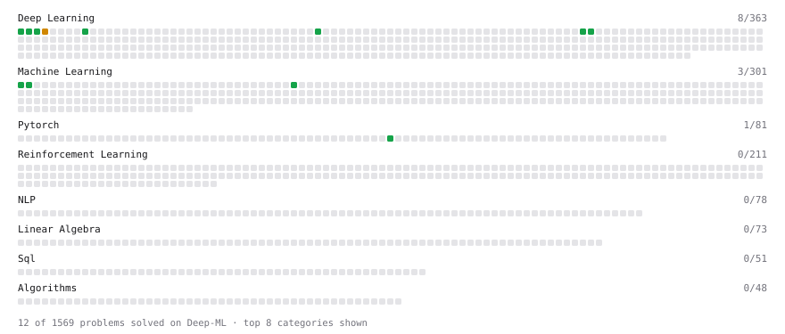

# Deep-ML

My machine learning practice from [Deep-ML](https://www.deep-ml.com). Every solution here was written by hand.

**19** solved · 19 problems · 0 labs · 0 math

[**Browse the interactive portfolio**](https://Vasu-Eranki.github.io/deep-ml/) to replay this filling in over time.

## Problems

| | Difficulty | Solved | |
| --- | --- | --- | --- |
| [Binary Classification with Logistic Regression](https://www.deep-ml.com/problems/104) | easy | 2026-10-15 | [solution](problems/0104-binary-classification-with-logistic-regression) |
| [Compute Multi-class Cross-Entropy Loss](https://www.deep-ml.com/problems/134) | easy | 2026-10-14 | [solution](problems/0134-compute-multi-class-cross-entropy-loss) |
| [Implement Binary Cross-Entropy Loss](https://www.deep-ml.com/problems/263) | easy | 2026-10-14 | [solution](problems/0263-implement-binary-cross-entropy-loss) |
| [Implement He Weight Initialization](https://www.deep-ml.com/problems/290) | easy | 2026-10-24 | [solution](problems/0290-implement-he-weight-initialization) |
| [Implement LayerNorm from Scratch](https://www.deep-ml.com/problems/908) | easy | 2026-10-23 | [solution](problems/0908-implement-layernorm-from-scratch) |
| [Implement ReLU Activation Function](https://www.deep-ml.com/problems/42) | easy | 2026-10-14 | [solution](problems/0042-implement-relu-activation-function) |
| [Implement RMSNorm (Root Mean Square Layer Normalization)](https://www.deep-ml.com/problems/372) | easy | 2026-10-23 | [solution](problems/0372-implement-rmsnorm-root-mean-square-layer-normalization) |
| [Implement the Tanh Activation Function](https://www.deep-ml.com/problems/264) | easy | 2026-10-15 | [solution](problems/0264-implement-the-tanh-activation-function) |
| [Linear Regression Using Gradient Descent](https://www.deep-ml.com/problems/15) | easy | 2026-10-15 | [solution](problems/0015-linear-regression-using-gradient-descent) |
| [Linear Regression Using Normal Equation](https://www.deep-ml.com/problems/14) | easy | 2026-10-15 | [solution](problems/0014-linear-regression-using-normal-equation) |
| [Momentum Optimizer](https://www.deep-ml.com/problems/146) | easy | 2026-10-15 | [solution](problems/0146-momentum-optimizer) |
| [One SGD Update Step](https://www.deep-ml.com/problems/1234) | easy | 2026-10-15 | [solution](problems/1234-one-sgd-update-step) |
| [Sigmoid Activation Function Understanding](https://www.deep-ml.com/problems/22) | easy | 2026-10-14 | [solution](problems/0022-sigmoid-activation-function-understanding) |
| [Single Neuron](https://www.deep-ml.com/problems/24) | easy | 2026-10-15 | [solution](problems/0024-single-neuron) |
| [Softmax Activation Function Implementation ](https://www.deep-ml.com/problems/23) | easy | 2026-10-14 | [solution](problems/0023-softmax-activation-function-implementation) |
| [Adam Optimizer](https://www.deep-ml.com/problems/87) | medium | 2026-10-23 | [solution](problems/0087-adam-optimizer) |
| [Implement RMSProp Optimizer](https://www.deep-ml.com/problems/200) | medium | 2026-10-15 | [solution](problems/0200-implement-rmsprop-optimizer) |
| [Implement Xavier/Glorot Weight Initialization](https://www.deep-ml.com/problems/289) | medium | 2026-10-23 | [solution](problems/0289-implement-xavier-glorot-weight-initialization) |
| [Single Neuron with Backpropagation](https://www.deep-ml.com/problems/25) | medium | 2026-10-15 | [solution](problems/0025-single-neuron-with-backpropagation) |

---

_This file is regenerated by Deep-ML on every push._
